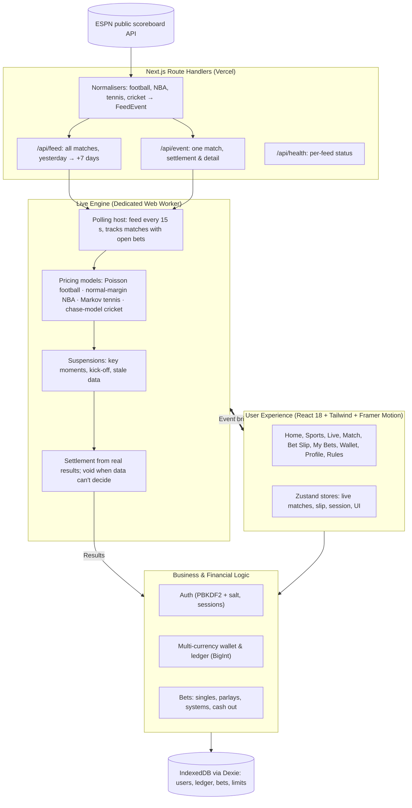

# CADNEX (CDNX)
### Virtual-Money Sportsbook on Real Matches & Live Scores

[](https://www.typescriptlang.org/)
[](https://nextjs.org/)
[](https://react.dev/)
[](https://tailwindcss.com/)
[](https://www.framer.com/motion/)
[](https://dexie.org/)
[](https://vitest.dev/)
[](#5-responsible-gaming--player-protection)
[](#license)

**Live:** [cadnex.vercel.app](https://cadnex.vercel.app)

---

## Executive Summary

**CADNEX** is a virtual-money sportsbook built on **real matches**. Fixtures, live scores and results come from ESPN's free public scoreboard data. CADNEX prices every market itself from the real state of each match (score, clock, red cards, sets, wickets) and settles bets automatically on the real result.

Everything a player stakes is virtual. There are no deposits, no withdrawals and no real-money risk, but the matches, the drama and the results are the real thing.

---

## Product Highlights

| Capability | What it means |
| :--- | :--- |
| **Real Matches, Live Scores** | Top football leagues, the NBA, ATP/WTA tennis and live cricket, updated every 15 seconds from ESPN's public feed. No API key or paid data contract. |
| **In-House Pricing** | Pre-match prices start from bookmaker lines published in the feed, then team ratings, records or rankings. In play they move with the real score and clock. |
| **Safe Live Betting** | Markets pause after goals, red cards, set changes and wickets, at kick-off, and whenever the live data is more than ~50 seconds old. |
| **Automatic Settlement & Cash Out** | Bets settle on the real result (football on the 90-minute score). Full and partial cash out at live fair value. |
| **Financial Integrity** | Every amount is a `BigInt` count of minor units across 56 fiat and crypto currencies, and every balance change writes an immutable ledger entry. |
| **Responsible Gaming** | Enforced deposit, loss, stake and single-bet limits, reality checks, breaks and self-exclusion. |
| **Light Infrastructure** | One Next.js app on Vercel. Edge caching means all visitors share a handful of upstream requests. |

---

## System Architecture



---

## Key Functional Modules

### 1. Real-Time Match Data
| Sport | Coverage | Markets |
| :--- | :--- | :--- |
| **Football** | Premier League, LaLiga, Serie A, Bundesliga, Ligue 1, Champions League, Europa League, Indian Super League, EFL Championship, Eredivisie, Primeira Liga, Saudi Pro League, MLS, Liga MX, Brasileirão, Liga Profesional | 1X2, double chance, draw no bet, totals, Asian handicap (incl. quarter lines), both teams to score, correct score, winning margin, odd/even, next goal |
| **Basketball** | NBA | Moneyline, spreads, totals, quarter winner |
| **Tennis** | ATP & WTA singles | Match winner, set betting, total sets, set winner |
| **Cricket** | Series covered by ESPN | Match winner (T20 & one-day) |

Data: live score, clock, period, goal and card timeline, team stats (where published), quarter and set lines, cricket innings and chase state.

### 2. Pricing & Live Odds
* **Football**: goal expectations solved from the published 1X2 prices, then the remaining goals are Poisson given the real minute, score, red cards and game state.
* **Basketball**: final margin and total modelled from the published spread and total, narrowing with the real game clock.
* **Tennis**: per-game strength from the pre-match price or rankings; exact set and match probabilities from the real games and sets.
* **Cricket**: chase model on runs needed, balls left and wickets in hand; projected total against par in the first innings.
* **Margins**: bookmaker-style overround per market (4.5–16%).

### 3. Professional Wagering Suite & Bet Slip
* **Bet Types**: Singles, Parlays (up to 20 legs) and System bets (2/3, 2/4, 3/4, Trixie, Patent, Yankee, Lucky 15, Canadian, Lucky 31, Heinz, Lucky 63).
* **Live Cash Out**: full or partial, priced from live fair value minus a margin.
* **Odds Change Policies**: accept any change, accept higher only, or always ask.
* **Booking Codes**: share a slip as a short code.

### 4. Multi-Currency Virtual Treasury & Ledger
* **56 Currencies**: fiat (USD, EUR, GBP, INR, JPY …) and crypto (BTC, ETH, SOL, USDT …), each with its own decimals.
* **Zero Floating-Point Drift**: all money is `BigInt` minor units.
* **Full Audit Trail**: every bet, win, refund, cash out, bonus and conversion is a ledger entry.
* **Demo Controls**: set, add or subtract any balance; simulated deposits and withdrawals.

### 5. Responsible Gaming & Player Protection
* Deposit, loss and stake limits per day, week or 30 days; lowering is instant, raising waits 24 hours.
* Single-bet limit, session reminders, breaks (24 h, 7 d, 30 d) and six-month self-exclusion.
* Mandatory 18+ check at onboarding.

### 6. Design System & User Experience
* Dark and light themes, frosted glass, ambient glow, dot-matrix scoreboards.
* Physics-based motion with Framer Motion; respects reduced-motion settings.
* Live-data badge showing the provider and how fresh the scores are.

---

## Technology Stack

| Layer | Technologies |
| :--- | :--- |
| **Framework** | [Next.js 14.2](https://nextjs.org/) (App Router, Route Handlers) + [React 18.3](https://react.dev/) + [TypeScript 5.9](https://www.typescriptlang.org/) |
| **Live Data** | ESPN public site API (unofficial, no key) |
| **Styling** | [Tailwind CSS 3.4](https://tailwindcss.com/) + [Geist](https://vercel.com/font) |
| **Animation** | [Framer Motion 14.6](https://www.framer.com/motion/) |
| **State** | [Zustand 5.0](https://github.com/pmndrs/zustand) |
| **Persistence** | [Dexie.js 4.4](https://dexie.org/) (IndexedDB) |
| **Icons** | [Lucide React](https://lucide.dev/) |
| **Cryptography** | Web Crypto API (PBKDF2-SHA-256) |
| **Testing** | [Vitest 2.1](https://vitest.dev/): money maths, ledger, settlement, cash out, feed parsing, pricing |

---

## Getting Started

### Prerequisites
* **Node.js** 18.17 or higher
* **npm** 9 or higher

### Installation
```bash
git clone https://github.com/VasavDotJS/cadnex-bet.git
cd cadnex-bet
npm install
```

### Development Server
```bash
npm run dev
```
Open `http://localhost:3000`.

### Production
```bash
npm run build
npm start
```

### Testing
```bash
npm test
```

### Mobile Wi-Fi Testing
```bash
npm run phone
```
Open `https://<your-computer-ip>:3000` on a phone on the same Wi-Fi and accept the one-time certificate warning. HTTPS is required for password hashing.

### Checking the Live Feed
After deploying, open **`/api/health`**. It lists every upstream feed, whether it answered, how many matches it returned, and a sample of live matches.

### Offline Mode
```bash
CADNEX_FIXTURES=/path/to/fixtures npm start
```
Serves ESPN-shaped JSON files (`eng.1.json`, `nba.json`, `atp.json`, `cricket.json`) instead of the network. `src/live/fixtures.ts` builds them.

### Deploying on Vercel
Set the project's **Framework Preset** to **Next.js** (Project Settings → Build & Deployment). No environment variables are needed.

---

## Directory Structure

```
cadnex-bet/
├── app/
│   ├── api/
│   │   ├── feed/route.ts      # All matches, normalised
│   │   ├── event/route.ts     # One match (settlement & detail)
│   │   └── health/route.ts    # Feed status page
│   ├── layout.tsx             # Fonts, theme, metadata
│   ├── page.tsx               # Loads the client app
│   └── globals.css            # Design tokens & utilities
├── src/
│   ├── feed/                  # ESPN fetching, normalisers, shared types
│   ├── live/                  # Live engine & pricing models per sport (+ tests, fixtures)
│   ├── engine/                # Worker host, client, protocol, market helpers
│   ├── core/                  # Bridge: engine ↔ app, settlement, notifications
│   ├── components/            # UI system: Crest, DotMatrix, OddsButton, Sheet, FeedBadge …
│   ├── features/              # auth, bets, event, help, home, notifications, profile,
│   │                          # responsible, search, shell, slip, sports, wallet
│   ├── data/                  # Competition catalogue, club ratings
│   ├── db/                    # Dexie schema
│   ├── lib/                   # Money, odds, currencies, crypto
│   ├── services/              # Auth, wallet, bets, stats, rewards
│   └── store/                 # Zustand stores
├── next.config.mjs
├── tailwind.config.mjs
├── tsconfig.json
└── vitest.config.ts
```

---

## Roadmap

* [ ] **Bet Builder (Same-Game Parlay)** with correlation pricing and contradiction blocking.
* [ ] **Promotions**: welcome bonus, odds boosts, free bets with wagering terms.
* [ ] **Shared Leaderboards** across friends (needs a small backend).
* [ ] **More Markets**: corners, cards and goalscorers when a free source can settle them.
* [ ] **Esports** if a free live source becomes available.
* [ ] **Internationalisation (i18n)**.

---

## Data & Responsible Gaming Disclaimer

> **IMPORTANT**: CADNEX is for entertainment and software demonstration only.
>
> * **No Real Money**: users cannot deposit, wager or withdraw real-world money.
> * **Real Data, Virtual Stakes**: fixtures and scores come from ESPN's public data and can run up to a minute behind live TV. CADNEX has no affiliation with ESPN or any league, team, player or bookmaker. ESPN's endpoints are unofficial and may change.
> * **Protection First**: built-in tools enforce personal play limits.

---

## Author & Maintainer

* **Vasav P Ramesh** ([@VasavDotJS](https://github.com/VasavDotJS))
* Repository: [https://github.com/VasavDotJS/cadnex-bet](https://github.com/VasavDotJS/cadnex-bet)

---

## License

This software and its documentation are proprietary. All rights reserved. For licensing inquiries, commercial partnerships, or custom integrations, please contact the maintainer.
