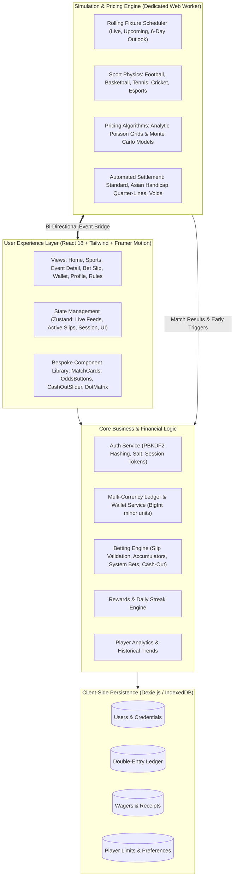

# CADNEX (CDNX)
### Next-Generation Virtual Sportsbook & Real-Time Simulation Engine

[](https://www.typescriptlang.org/)
[](https://react.dev/)
[](https://vitejs.dev/)
[](https://tailwindcss.com/)
[](https://www.framer.com/motion/)
[](https://dexie.org/)
[](https://vitest.dev/)
[](#responsible-gaming--player-protection)
[](#license)

---

## Executive Summary

**CADNEX** is an enterprise-grade, high-fidelity virtual sportsbook powered by a fully client-side mathematical simulation engine. Built for iGaming operators, sports media platforms, fintech prototypes, and regulatory sandboxes, Cadnex delivers the authentic thrill, depth, and operational mechanics of a world-class sportsbook—**without real-money risk or third-party live data licensing costs**.

Every match is dynamically simulated in real time inside a dedicated browser **Web Worker**, generating authentic possession-by-possession events, live state changes, and continuous algorithmic price updates. With automatic settlement, full cash-out capabilities, multi-currency ledger accounting, and an ultra-responsive mobile-first design, Cadnex represents the benchmark for next-generation sports gaming demonstration platforms.

---

## Product Highlights & Client Value

| Capability | Client Benefit |
| :--- | :--- |
| **Zero External Feed Dependencies** | Eliminates costly live data feeds (Sportradar, Genius Sports). All matches and odds are generated locally via calibrated mathematical models. |
| **100% Client-Side Architecture** | Runs seamlessly in-browser on desktop, tablet, and mobile with near-zero server infrastructure costs. |
| **Instant Settlement & Cash Out** | Full and partial cash-out algorithms calculate real-time fair market value with automated settlement on match completion. |
| **Financial Integrity** | Double-entry BigInt ledger accounting prevents floating-point inaccuracies across 56 supported fiat and crypto currencies. |
| **Regulator & Compliance Ready** | Integrated Responsible Gaming module featuring enforced deposit/loss limits, session timers, and self-exclusion tooling. |
| **Portable & Embeddable** | Can be deployed as a standard web application, PWA, or bundled into a single standalone HTML file with inlined worker assets. |

---

## System Architecture



---

## Key Functional Modules

### 1. Multi-Sport Simulation Engine
Matches run autonomously 24/7 across five major sporting categories using sports-specific probability distributions:

* **Football (Soccer)**: Dynamic Poisson shot distribution conditioned on Expected Goals (xG), match tempo, home advantage, and disciplinary action (yellow/red cards).
* **Basketball**: Possession-by-possession simulation modeling pace, offensive/defensive ratings, foul trouble, and clutch shooting.
* **Tennis**: Markov-chain point-by-point simulation factoring in first-serve win percentages, unforced errors, break points, and tiebreaks.
* **Cricket (T20)**: Ball-by-ball physics simulating pitch decay, strike rates, wickets in hand, powerplay phases, and required run-rates.
* **Esports**: 
  * *CS2 / Valorant*: Round-by-round buy mechanics (eco, force-buy, full-buy), weapon tiers, and clutch defusals.
  * *MOBA (League of Legends)*: Minute-by-minute objective control (Dragon, Baron Nashor, Tower destruction, gold differentials).

> **Fair Play & Unpredictability**: Randomness is derived strictly from the browser's cryptographic source (`crypto.getRandomValues`). Match outcomes are never predetermined, allowing for organic underdogs, dramatic comebacks, and genuine variance.

### 2. Algorithmic Pricing & Real-Time Odds
* **Live Mathematical Modeling**: Football prices use an analytic Poisson grid calculated over the remaining regulation minutes; other sports utilize high-speed Monte Carlo simulations.
* **Dynamic Margins**: Configurable overround applied across all market types to replicate real-world bookmaker economics.
* **Instant Suspensions**: Automated market locks triggered during critical high-leverage moments (VAR reviews, penalties, red cards, break points).
* **Deep Market Coverage**:
  * Match Winner / 1X2 / Moneyline
  * Asian Handicaps (including quarter-lines: -0.25, -0.75, +1.25 with half-win / half-push logic)
  * Over / Under Totals
  * Both Teams to Score (BTTS) & Double Chance
  * Correct Score & Spreads

### 3. Professional Wagering Suite & Bet Slip
* **Bet Types**: Full support for Singles, Parlays / Accumulators (Accas), and Complex Multi-Bet Systems (Trixie, Yankee, Canadian, Heinz, Super Heinz, Goliath).
* **Live Cash Out**:
  * **Full Cash Out**: One-tap settlement based on live probabilistic market value.
  * **Partial Cash Out**: Interactive slider allowing users to secure profits while keeping a portion of their stake in play.
* **Odds Change Policies**: User-selectable policies (*Accept Higher Odds*, *Accept Any Changes*, *Always Confirm*).
* **Booking Codes**: Shareable bet configurations for instant cross-device slip loading.

### 4. Multi-Currency Virtual Treasury & Financial Ledger
* **56 Supported Currencies**: Broad coverage of global fiat (USD, EUR, GBP, JPY, CAD, AUD, etc.) and cryptocurrencies (BTC, ETH, SOL, USDT, etc.).
* **Zero Floating-Point Drift**: All currency values are calculated and stored as `BigInt` minor units (e.g., cents, satoshis) to eliminate precision loss.
* **Full Audit Trail**: Every transaction (bet placement, win settlement, cash-out, bonus, conversion) writes an immutable record to the local double-entry ledger.
* **Instant Conversions**: Real-time cross-currency swaps with live conversion rates.

### 5. Responsible Gaming & Player Protection
Cadnex includes an end-to-end Responsible Gaming framework adhering to international iGaming standards:
* **Custom Financial Caps**: Daily, weekly, and monthly deposit, loss, and wager limits.
* **Reality Checks & Session Reminders**: Configurable pop-up notifications tracking time spent playing.
* **Time-Out & Self-Exclusion**: Irreversible cool-off periods (24 hours to 30 days) and full self-exclusion lockouts.
* **Age Verification Guardrails**: Mandatory 18+ validation during onboarding.

### 6. Design System & User Experience
* **Theming**: Flawless Dark Mode and Light Mode support with glowing accents, tactile contrast, and glassmorphic depth.
* **Physics-Based Animation**: Powered by Framer Motion for natural page transitions, sheet slides, and tactile press feedback.
* **Micro-Interactions**: Real-time odds flash indicators (green tick up, red tick down), dot-matrix scoreboards, celebratory confetti, and contextual toast alerts.

---

## Technology Stack

| Layer | Technologies |
| :--- | :--- |
| **Frontend Framework** | [React 18.3](https://react.dev/) + [TypeScript 5.9](https://www.typescriptlang.org/) |
| **Build & Tooling** | [Vite 5.4](https://vitejs.dev/) + [PostCSS](https://postcss.org/) |
| **Styling & Design System** | [Tailwind CSS 3.4](https://tailwindcss.com/) + Custom Glassmorphic Utilities |
| **Animation & Motion** | [Framer Motion 14.6](https://www.framer.com/motion/) |
| **State Management** | [Zustand 5.0](https://github.com/pmndrs/zustand) |
| **Database & Persistence** | [Dexie.js 4.4](https://dexie.org/) (High-performance IndexedDB wrapper) |
| **Iconography** | [Lucide React 1.61](https://lucide.dev/) |
| **Cryptography** | Web Crypto API (`crypto.getRandomValues`, PBKDF2 with SHA-256) |
| **Testing Framework** | [Vitest 2.1](https://vitest.dev/) (Unit, settlement, cash-out & financial tests) |

---

## Getting Started

### Prerequisites
* **Node.js**: v18.0.0 or higher
* **npm**: v9.0.0 or higher

### Installation

```bash
# Clone the repository
git clone https://github.com/VasavDotJS/cadnex-bet.git
cd cadnex-bet

# Install dependencies
npm install
```

### Development Server

Run the development server locally:
```bash
npm run dev
```
Open your browser and navigate to `http://localhost:5173`.

### Testing

Execute the comprehensive test suite verifying financial math, currency conversions, settlement rules, and cash-out algorithms:
```bash
npm test
```

### Production Build

Create an optimized, type-checked production bundle:
```bash
npm run build
```
Artifacts will be output to the `dist/` directory.

### Single-File Portable Distribution

Generate a 100% self-contained, single-file HTML executable with the Web Worker and all stylesheets/scripts inlined:
```bash
SINGLE=1 npx vite build
```
This produces a portable `dist/index.html` that can be run offline from any local drive or distributed as a demonstration asset.

### Mobile Wi-Fi Testing

To test the responsive mobile experience on your physical smartphone over your local Wi-Fi:
```bash
npm run phone
```
The console will display a local network HTTPS URL. Open that URL on your phone's browser (accept the self-signed certificate on initial load).

---

## Directory Structure

```
cadnex/
├── src/
│   ├── app/               # Application bootstrap & runtime bridge
│   ├── components/        # Signature UI component system
│   │   ├── Ambient.tsx        # Ambient gradient background lighting
│   │   ├── Crest.tsx          # Team crests & visual badges
│   │   ├── CurrencyPicker.tsx # Multi-currency selector modal
│   │   ├── DotMatrix.tsx      # Vintage stadium-style scoreboard
│   │   ├── match.tsx          # Live & upcoming match presentation cards
│   │   ├── Money.tsx          # Formatted currency & financial displays
│   │   ├── OddsButton.tsx     # Animated odds button with tick flash
│   │   ├── Sheet.tsx          # Interactive bottom sheet drawer
│   │   ├── Sparkline.tsx      # SVG trendline charts for momentum
│   │   └── ui.tsx             # Core primitives (Buttons, Inputs, Tabs, Modals)
│   ├── data/              # Team rosters, leagues, ratings & fixture seeds
│   ├── db/                # Dexie.js IndexedDB schema & migrations
│   ├── engine/            # Real-time Web Worker simulation & pricing engine
│   │   ├── sports/            # Sport models (Football, Basketball, Tennis, Cricket, Esports)
│   │   ├── client.ts          # Main-thread RPC client for the worker
│   │   ├── engine.ts          # Core match orchestrator & event emitter
│   │   ├── host.ts            # Web Worker host process
│   │   └── worker.ts          # Dedicated Web Worker script
│   ├── features/          # High-level domain modules
│   │   ├── auth/              # Secure sign-in, onboarding & account isolation
│   │   ├── bets/              # Active wagers, historical receipts & cash-out
│   │   ├── event/             # In-depth match tracker & live market boards
│   │   ├── help/              # Sports rules, bet type guides & FAQs
│   │   ├── home/              # Hero cards, live carousels & trending accas
│   │   ├── notifications/     # Event alerts, wins & settlement notices
│   │   ├── profile/           # User statistics, streak tracking & settings
│   │   ├── responsible/       # Responsible gaming limit controls & self-exclusion
│   │   ├── search/            # Universal search palette for teams and leagues
│   │   ├── shell/             # Main navigation bar, header & layout shell
│   │   ├── slip/              # Interactive bet slip & accumulator builder
│   │   ├── sports/            # Category directory & upcoming schedule
│   │   └── wallet/            # Virtual banking, conversions & ledger history
│   ├── lib/               # Mathematical formulas, odds formatters & currency tables
│   ├── services/          # Core business services (Auth, Wallet, Bets, Rewards)
│   └── store/             # Zustand reactive state stores
├── index.html             # Application entrypoint
├── package.json           # Project manifest & dependencies
├── tailwind.config.js     # Design system & color palette configuration
├── tsconfig.json          # TypeScript compiler options
└── vite.config.ts         # Vite bundler & single-file plugin setup
```

---

## Roadmap & Upcoming Enhancements

* [ ] **Bet Builder (Same-Game Parlay)**: Correlated pricing algorithms with automatic contradiction blocking.
* [ ] **Promotional Engine**: Automated welcome deposit bonuses, odds boosts, and wagering requirement tracking.
* [ ] **Social Leaderboards**: Weekly profit rankings with simulated rival bot profiles.
* [ ] **Internationalization (i18n)**: Multi-language string catalog supporting English, Spanish, Portuguese, German, and French.
* [ ] **Expanded Sports Coverage**: Formula 1 racing, American Football (NFL), and Baseball (MLB).

---

## Responsible Gaming Disclaimer

> **IMPORTANT**: CADNEX is strictly a simulation platform intended exclusively for entertainment, education, and software demonstration purposes.
> 
> * **No Real Money**: Users cannot deposit, wager, or withdraw real-world currency or monetary assets.
> * **No Gambling Services**: All stakes, payouts, and balances are purely virtual units.
> * **Protection First**: Cadnex actively encourages healthy gaming habits and provides built-in tools to enforce personal play limits.

---

## Author & Maintainer

* **Vasav P Ramesh** ([@VasavDotJS](https://github.com/VasavDotJS))
* Repository: [https://github.com/VasavDotJS/cadnex-bet](https://github.com/VasavDotJS/cadnex-bet)

---

## License

This software and its documentation are proprietary. All rights reserved. For licensing inquiries, commercial partnerships, or custom integrations, please contact the maintainer.
