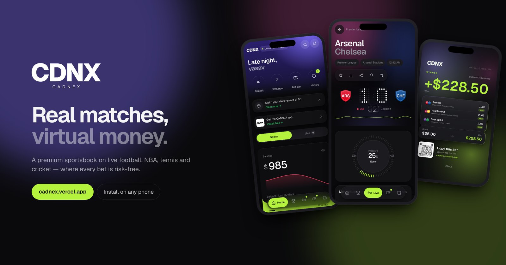
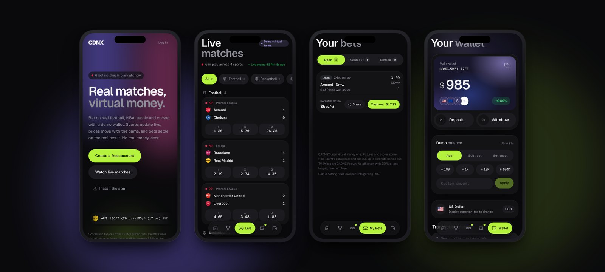
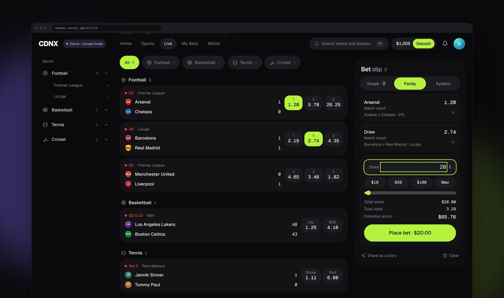
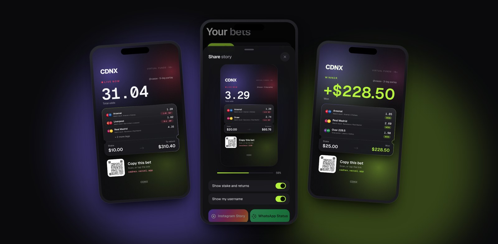
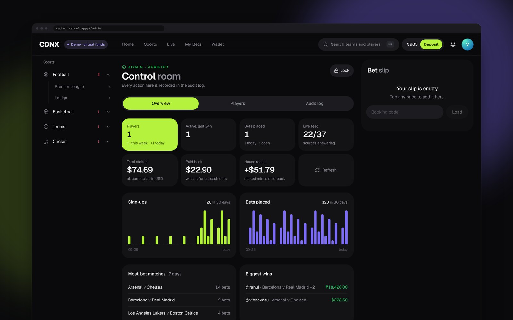

<p align="center">
  <a href="https://cadnex.vercel.app"></a>
</p>

<p align="center">
  A premium sportsbook on live football, NBA, tennis and cricket,<br>
  where every bet is played with a demo wallet and settled on the real result.
</p>

<p align="center">
  <a href="https://cadnex.vercel.app"><b>Open CADNEX →</b></a>
  &nbsp;·&nbsp;
  <a href="#install-it-like-an-app">Install on your phone</a>
  &nbsp;·&nbsp;
  <a href="#share-your-wins">See the story cards</a>
</p>

---

## Why CADNEX

Sports betting is thrilling to watch and risky to play. CADNEX keeps the thrill and drops the risk. The matches, scores and results are **real and live**, but the money is **virtual**. Nobody deposits, nobody loses a rupee, and everyone gets the full experience of a world-class sportsbook.

It's built to feel like a flagship app, not a demo: fluid motion, a refined dark design, live prices that react to every goal, and moments worth sharing.

<table>
  <tr>
    <td width="33%" valign="top">
      <h4>⚡ Live, for real</h4>
      Top football leagues, the NBA, ATP &amp; WTA tennis and cricket, with scores that update every few seconds.
    </td>
    <td width="33%" valign="top">
      <h4>🎯 Prices that move</h4>
      Odds react to the match as it happens: a goal, a red card, a break of serve, a wicket.
    </td>
    <td width="33%" valign="top">
      <h4>🛡️ Zero real money</h4>
      A demo wallet in 56 currencies. Top it up, set any balance, and play with nothing at stake.
    </td>
  </tr>
  <tr>
    <td valign="top">
      <h4>📲 Install it like an app</h4>
      Add it to the home screen on Android and iPhone. It opens full screen, starts instantly, and works offline.
    </td>
    <td valign="top">
      <h4>☁️ One account, every device</h4>
      Sign in on your phone, laptop or a friend's tablet. Your balance and bets follow you, live.
    </td>
    <td valign="top">
      <h4>🎬 Built to be shared</h4>
      Turn any bet into an animated story for Instagram and WhatsApp, with a code friends scan to copy it.
    </td>
  </tr>
</table>

---

## A first impression that sticks


Every launch opens with a **liquid logo**. Scattered droplets spiral in, merge like liquid metal with a lime and violet sheen, and pour into the CDNX wordmark, which sharpens into the logo before the app glides in.

It runs on the phone's graphics chip, takes about two seconds, and never slows the app down. People who prefer reduced motion get a calm fade instead.

<br clear="right">

---

## Every screen, considered

<p align="center">
  
</p>

- **Live match centre:** a dot-matrix scoreboard, momentum and pressure gauges, live stats and a timeline of key moments.
- **Bet slip:** singles, parlays and system bets, quick stakes, a built-in keypad, and full or partial **cash out** at live value.
- **My Bets:** every leg tracked live, with clear wins, losses and pending legs, and a receipt for every bet.
- **Wallet:** a polished card with balance history, demo deposits and withdrawals, and instant currency switching.
- **Light and dark themes**, with smooth, physics-based motion throughout.

<p align="center">
  
</p>

---

## Share your wins

<p align="center">
  
</p>


Any bet, or the picks in your slip, becomes a **6-second animated story** made right on the phone:

- the odds or winnings **spin into place** like a slot machine;
- a glass ticket rises in with a **light that travels round its border**;
- live matches pulse with the **real score**;
- winners get a lime glow and **confetti**.

One tap opens **Instagram Stories** or **WhatsApp Status**. Each story carries a **QR code and link**: friends who scan it see your picks with today's prices and copy them into their own slip in one tap. Switches let you hide your stake or your username.

<br clear="left">

---

## Install it like an app

CADNEX installs straight from the browser. No app store needed.

| | |
|---|---|
| **Android** | Tap **Install free** on the home screen banner, or **⋮ → Install app** in Chrome. |
| **iPhone & iPad** | In Safari, tap **Share → Add to Home Screen**. |
| **Desktop** | Click the install icon at the end of the address bar in Chrome or Edge. |

Once installed it has its own icon, launch screen and home-screen shortcuts (Live, My bets, Wallet), opens full screen, and still opens with no signal.

---

## For the operator

<p align="center">
  
</p>

A private **control room** shows how CADNEX is doing:

- **At a glance:** players, sign-ups, daily activity, bets placed, total staked and the house result.
- **Trends:** 30-day charts of sign-ups and bets, the most-bet matches and the biggest wins.
- **Players:** search everyone, see balances and history, **gift credits** or **ban** in a tap.
- **Audit log:** every admin action is recorded.

It's locked down properly. The panel is invisible to everyone else, needs the owner's password **plus a code from an authenticator app**, re-locks when idle, and every check is enforced by the database itself, not just the screen.

---

## Play responsibly, even with virtual money

CADNEX is built around healthy play:

- deposit, loss, stake and single-bet **limits**;
- **reality checks** that show time played and session result;
- **cool-off breaks** and **self-exclusion**;
- an **18+ check** at the door, with clear "virtual funds" labelling everywhere.

---

## Trust and privacy

- **Each player sees only their own data.** Accounts are protected in the database itself, not just in the app.
- **Passwords are never stored by CADNEX.** Sign-in is handled by an industry-standard authentication service.
- **Works offline, syncs when back.** Your device keeps a private copy so the app stays instant, and logging out removes it.
- **No real money, ever.** There are no payments, no deposits and no withdrawals of real funds.

---

## Under the hood

Built with a modern, lightweight stack and no paid data contracts:

<p>
  
  
  
  
  
  
  
  
</p>

- **One app, everywhere:** a single web codebase serves phones, tablets and desktops, and installs as an app.
- **Real-time engine:** CADNEX prices every market itself from the live state of each match and settles bets automatically.
- **Exact money:** every balance change is recorded in a permanent ledger, with no rounding errors in any currency.
- **Cloud accounts:** Supabase for sign-in and storage, with live sync across a player's devices.
- **Free to run:** hosted on Vercel's and Supabase's free plans.

<details>
<summary><b>Run it yourself</b></summary>
<br>

Requires Node.js 18.17 or newer.

```bash
npm install
npm run dev        # http://localhost:3000
npm run build && npm start
npm test           # unit tests
```

Deploys to Vercel with no extra configuration. Database setup lives in `supabase/migrations/`.

</details>

---

## What's next

- [ ] **Leaderboards**: weekly rankings by profit, win rate and biggest win
- [ ] **Private leagues**: invite friends and compete on your own table
- [ ] **Bet Builder**: combine picks from the same match
- [ ] **Anytime goalscorer** markets
- [ ] **Push notifications** for goals and settled bets
- [ ] **Achievements** and streaks

---

<p align="center">
  <sub>
    CADNEX uses virtual money only and is for adults (18+). Fixtures and scores come from public sports data and can run a little behind live TV.<br>
    CADNEX is not affiliated with any league, team, player or data provider.
  </sub>
</p>

<p align="center">
  Made by <b>Vasav P Ramesh</b> · <a href="https://github.com/VasavDotJS">@VasavDotJS</a><br>
  <sub>© CADNEX. All rights reserved. For partnerships or licensing, get in touch.</sub>
</p>
